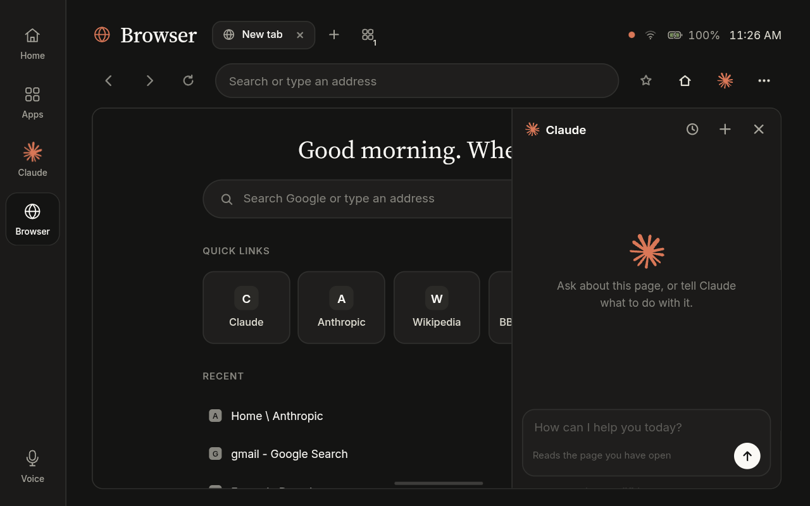

<p align="center">
  <picture>
    <source media="(prefers-color-scheme: dark)" srcset="docs/media/logo-dark.svg">
    
  </picture>
</p>

<h3 align="center">A home screen for the kitchen wall, run by Claude Code on your PC.</h3>

<p align="center">
  <a href="#get-started">Get started</a> ·
  <a href="docs/SETUP.md">Setup guide</a> ·
  <a href="docs/SECURITY.md">Security</a> ·
  <a href="#contribute">Contribute</a>
</p>

<p align="center">
  
  &nbsp;
  
</p>

---

## Why ClaudeOS

ClaudeOS puts your day on one shared screen: the time, the weather, your calendar, your photos and your family lists. A small hub server on your PC serves the page and talks to Claude Code. You can follow and answer your Claude sessions from across the room.

- **One screen for the home.** Clock, weather, calendar, photos and lists, built for a wall or a counter.
- **Claude in the room.** Read your Claude Code sessions, reply, approve tools and start new ones.
- **Voice for quick jobs.** Say "Hey Claude" on the tablet. Timers, alarms, lists, weather, calendar, routines and Home Assistant devices answer at once. Anything else goes to Claude.
- **Runs on your network.** The hub runs on your own PC and serves only your home network.

## Apps

| App | What it does |
|---|---|
| **Home** | A greeting, the time and an overview of the day. |
| **Claude** | Your Claude Code sessions: read, reply, approve tools, start new ones. |
| **Weather** | The forecast for your place. |
| **Calendar** | Day, week, month and year views, from ICS links or the Claude calendar connector. |
| **Photos** | A photo frame of pictures you add. |
| **Lists** | Shared family lists that Claude can read and change. |
| **Routines** | Named lists of steps, run by voice, a Home tile or Claude. |
| **Home Assistant** | Lights, scenes and devices, if you run Home Assistant. |
| **Clock** | Clock, timer, stopwatch and alarm. |
| **Browser** | Web tabs with a Claude side panel (tablet). |
| **Camera** | Photos, and "Ask Claude about this" (tablet). |
| **Apps** | The launcher. |
| **Settings** | Profile, PINs, plugins and more. |

<!--
## Screens

Product screenshots go here once they are captured.
Add each image under docs/media/ and reference it with a short alt text.
-->

## Requirements

- Node.js 22.18 or newer.
- The Claude Code CLI, signed in to your Claude account.
- A PC on your home network to run the hub. Leave it on.
- Optional: a Nest Hub or Chromecast and [`catt`](https://github.com/skorokithakis/catt), to keep the page cast to it.
- Optional: an Android tablet. The full-screen tablet app comes in a later release. Until then, open the page in the tablet's browser.

## Get started

```
npm install
npm run setup
npm start
```

1. `npm run setup` asks for this PC's address, a port (default 8000) and an optional cast device. It writes `config.json`.
2. `npm start` runs the hub. Open `http://<your PC's address>:8000` in a browser on your home network.
3. Open **Settings → Security** and set the ClaudeOS PIN before you put the screen somewhere shared.

The full steps, the `config.json` keys and the optional tablet build are in [docs/SETUP.md](docs/SETUP.md). On Windows, the tray app in [`host/`](host/) keeps the hub running.

## Security

ClaudeOS trusts your home network. The hub serves plain HTTP with no sign-in, and the page can answer your Claude Code sessions. Never expose the hub to the internet. Read [docs/SECURITY.md](docs/SECURITY.md) for the trust model, the PINs and the files to keep private.

## Contribute

Contributions are welcome. Every change goes through a branch and a pull request into `main`.

1. Create a branch from `main`.
2. Write commits in the [Conventional Commits](https://www.conventionalcommits.org/en/v1.0.0/) format, for example `feat(voice): name a timer`.
3. Run `npm run check` and `npm test`.
4. Open a pull request with the sections **Why**, **What** and **Tests**.

Read [CLAUDE.md](CLAUDE.md) for the code rules, the web import rules and the no-visible-Android rule.
