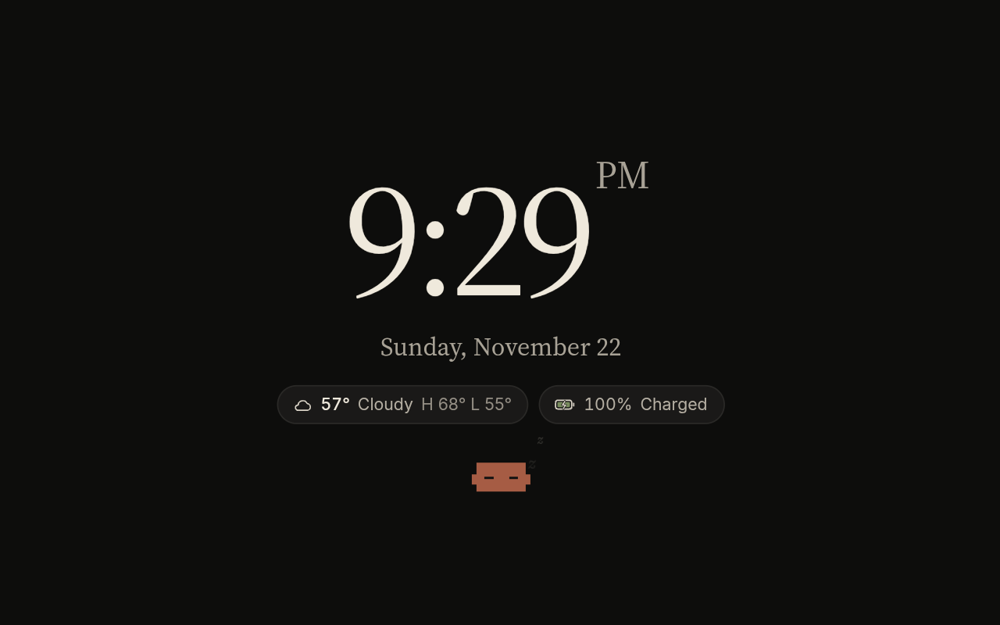
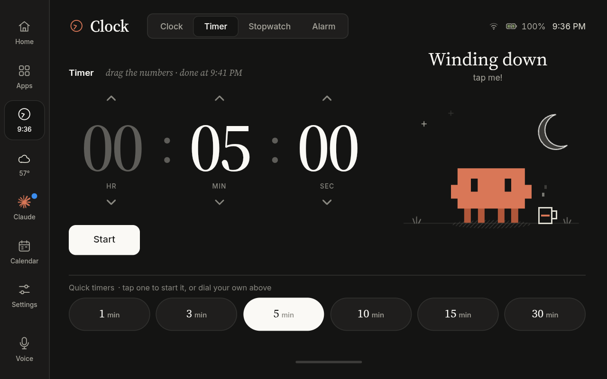

<p align="center">
  <picture>
    <source media="(prefers-color-scheme: dark)" srcset="docs/media/logo-dark.svg">
    
  </picture>
</p>

<p align="center">
  A home screen for your desk, powered by Claude Code.
</p>

<p align="center">
  <a href="#get-started">Get started</a> ·
  <a href="docs/SETUP.md">Setup guide</a> ·
  <a href="docs/SECURITY.md">Security</a> ·
  <a href="#contributing">Contributing</a>
</p>

<p align="center">
  <a href="https://github.com/deansasek/claude-os/actions/workflows/ci.yml"></a>
  
  
  
</p>

<p align="center">
  
  &nbsp;
  
</p>

---

## About

ClaudeOS shows your day on one shared screen: the time, the weather, your calendar, your photos and your family's lists. A small hub on your PC serves the page and connects it to Claude Code, so you can follow and answer your Claude sessions from anywhere in the room.

## Apps

| App | Description |
|---|---|
| Home | A greeting, the time and an overview of the day. |
| Claude | Your Claude Code sessions. Read, reply, approve tools and start new ones. |
| Weather | The forecast for your location. |
| Calendar | Day, week, month and year views, from ICS links or the Claude calendar connector. |
| Photos | A photo frame of the pictures you add. |
| Lists | Shared family lists that Claude can read and change. |
| Routines | Named sequences of steps, started by voice, a Home tile or Claude. |
| Home Assistant | Lights, scenes and devices, if you run Home Assistant. |
| Clock | Clock, timer, stopwatch and alarm. |
| Browser | Web tabs with a Claude side panel. Tablet only. |
| Camera | Photos and "Ask Claude about this." Tablet only. |
| Apps | The app launcher. |
| Settings | Profile, PINs, plugins and more. |

## Screens

<p align="center">
  
</p>

## Requirements

- Node.js 22.18 or newer.
- The Claude Code CLI, signed in to your Claude account.
- A PC on your home network to run the hub. Keep it on.
- Optional: a Nest Hub or Chromecast, with [`catt`](https://github.com/skorokithakis/catt), to cast the page.
- Optional: an Android tablet. A full-screen tablet app comes in a later release.

## Get started

```
npm install
npm run setup
npm start
```

1. `npm start` runs the hub. Open `http://<your PC's address>:8000` in a browser on your home network.
2. In **Settings**, open **Security** and set a PIN before you put the screen somewhere shared.

The full guide, including the `config.json` options and the tablet build, is in [docs/SETUP.md](docs/SETUP.md). On Windows, the tray app in [`host/`](host/) keeps the hub running.

## Security

The hub trusts your home network. It serves plain HTTP with no sign-in. Do not expose it to the internet. See [docs/SECURITY.md](docs/SECURITY.md) for the trust model, PINs and the files to keep private.

## Contributing

Every change goes through a branch and a pull request into `main`.

1. Create a branch from `main`.
2. Write commits in the [Conventional Commits](https://www.conventionalcommits.org/en/v1.0.0/) format, for example `feat(voice): name a timer`.
3. Run `npm run check` and `npm test`.
4. Open a pull request with the sections **Why**, **What** and **Tests**.

See [CLAUDE.md](CLAUDE.md) for the code rules, the web import rules and the no-visible-Android rule.
